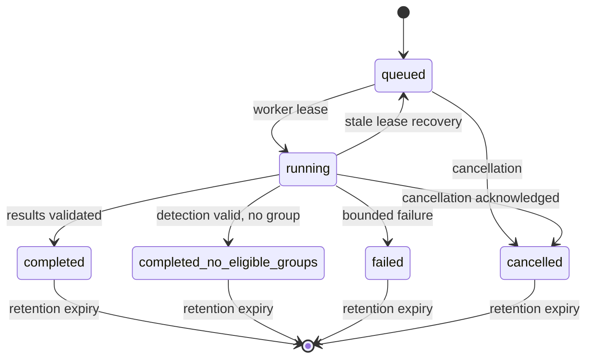

# Architecture and API lifecycle

## Trust boundaries

The GitHub Pages application is untrusted static code from the API's point of
view. It receives no global API secret. The public TLS edge forwards only to a
loopback listener. FastAPI validates and queues bounded requests; it cannot
select executable paths or run scientific tools. A separate worker process
claims durable jobs and invokes fixed argument arrays from
the selected `.runtime/toolsets/<id>/runners.json`.

Scientific source and environments are read-only to the worker. Only
`/srv/crispr/jobs/web` is writable; service logs go to the systemd journal.
Each job gets a new mode-0700 directory. SpacerPlacer, CRISPR-evOr,
CRISPRidentify, CasAndra, CRISPRtracrRNA and Integration remain in isolated Python environments because
their dependencies and shared module names are not safely co-installable.

The current units use the same unprivileged `crisprsvc` Unix identity for the
API, worker, and scientific children. Process and network confinement are
separate, but filesystem identity is not; this is a documented cross-job blast
radius and is why the public policy excludes sensitive data.

## Versioned API

Public endpoints live under `/api/v1`:

- `GET /health`, `GET /config`, and `GET /version`;
- `POST /jobs` to validate, normalize, persist, and enqueue input;
- `GET /jobs/{job_id}` to poll a capability-protected job;
- `DELETE /jobs/{job_id}` to request cancellation;
- `GET /jobs/{job_id}/result` for the registered ZIP bundle;
- `GET /jobs/{job_id}/artifacts/{artifact_id}` for a registered attachment.

Job identifiers are non-secret locators. Creation returns a separate random
256-bit token once. Subsequent calls send it in `Authorization: Bearer`; the
token never appears in an API path/query, database, log, provenance file, or
archive. The Vue client may retain it in the client-only `#job=` fragment for
explicit recovery; that complete link is a bearer secret.

## State machine

SQLite uses WAL mode and atomic transactions for queue capacity, per-client rate
events, claims, leases, cancellation, completion, and artifact registration.
The worker heartbeats independently. On restart, a stale running lease is
requeued with a bounded attempt count rather than silently lost.

## Worker mapping

| Public mode | Integration selection | Definitive result |
| --- | --- | --- |
| `loci` | `--tools loci` | CRISPRtracrRNA complete report and nested array/Cas evidence |
| `cas` | `--tools casandra` | CasAndra schema-5 genome reports |
| `tracrrna` | `--tools tracrrna` | CRISPRtracrRNA model report |
| `detection` | `--tools identify` | versioned CRISPRidentify summaries |
| `reconstruction` | `--tools spacerplacer` | SpacerPlacer `0_results.csv` |
| `orientation` | `--tools crispr-evor` | evOr JSON plus evOr-selected `0_results.csv` |

All invocations use argument vectors with `shell=False`, a new process group,
per-stage deadline, cancellation checks, and a total job deadline. Exit zero is
not sufficient: required files and machine-readable schemas are validated
before completion.

## Artifacts

A completed job registers only allowlisted, regular, in-tree files. Downloads
resolve an opaque artifact ID, re-check the canonical path, reject symlinks,
verify the recorded size, force attachment disposition, and never serve
tool-generated HTML or pickle. The generated ZIP contains normalized inputs,
safe results, logs, citations, and sanitized provenance; raw
`integration_result.json` is not exposed because it records operator paths and
commands.
