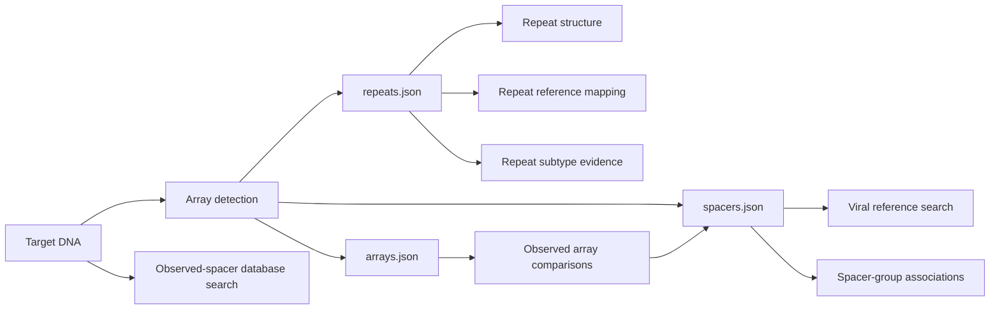

# Composable analysis outputs

Backend/frontend 2.5.0 adds typed sequence ports to independent jobs. Download a
port and upload its JSON to a compatible mode, or submit its text through the
existing API `sequence` field. Every step retains its own options, capability,
cancellation and retention.

In **Files & methods**, choose a sequence file and destination under **Continue
with these sequences**, then select **Use as analysis input**. This downloads the
complete capability-protected file into a new form. Review the destination's
limits, molecule and options before submitting. Source grouping remains an
explicit choice. The previous job and recovery link remain available until the
new submission succeeds; save that link if you need to revisit it.

Backend/frontend 2.6.0 extends this with a primary [compact `result.json` for
every mode](module-results.md). That file carries module-specific scientific
findings; sequence ports provide the typed inputs for subsequent jobs.



## Design basis

[CWL](https://www.commonwl.org/v1.2/Workflow.html) connects typed outputs to
compatible inputs. We apply that principle to biological roles: a spacer query,
repeat occurrence and genomic target are different types despite containing DNA.
[JSON Schema](https://json-schema.org/understanding-json-schema/structuring)
supports reusable definitions; our [versioned schema](schemas/sequence-set-v1.json)
defines records and origins once. Runtime checks additionally enforce uniqueness,
alphabets, interval lengths and mode/resource constraints.
[GA4GH WES](https://ga4gh.github.io/workflow-execution-service-schemas/docs/)
distinguishes execution state, logs and outputs. Here, provenance carries run
identity, effective options, versions, hashes and citations; sequence files carry
biological data. These are design influences, not claims of CWL/WES compliance.

## Files and connections

| File | Contents | Consumer |
| --- | --- | --- |
| `result.json` | Compact scientific findings for the selected mode | Versioned module-result consumers |
| `arrays.json` | Compact accepted-array evidence and uncertainty | `array_compare` (CCTK observed sharing) |
| `repeats.json` | Source-verified repeat occurrences | `repeats`, `repeat_map`, `repeat_type` |
| `spacers.json` | Source-verified non-deleted spacer occurrences | `viral_search`, `spacer_association` |
| `input-sequences.json` | Complete input with any supplied origins | Modes accepting the same role/molecule |
| Existing scientific JSON/TSV | Folds, matches, annotations, histories | Consumers of those scientific contracts |
| Provenance and ZIP | Reproducibility and native detail | Audit and advanced consumers |

Every successful mode exports `input-sequences.json`, including success with no
eligible evolutionary groups. Detection, reconstruction, orientation, leader,
repeat-context, prophage-context and complete-locus jobs also export the three array files. Prophage-context exports reuse already validated detector evidence with accepted-category filtering; they do not rerun detection or derive new arrays from prophage calls.
Full native reports supply these files, independently of browser preview caps.
Native output remains available for compatibility and detailed investigation.

Array comparison additionally exports `spacers.json`, with every observed
occurrence, its source annotations and original array ordinal. Deletion slots
remain in `arrays.json`; they never become artificial DNA. The comparison's
`input-sequences.json` is a **spacer** port, while its `arrays.json` is the input
for another comparison. Uploaded origins remain client-supplied annotations.

Review the generated examples: [arrays](examples/module-exchange/arrays.json),
[repeats](examples/module-exchange/repeats.json), and
[spacers](examples/module-exchange/spacers.json). They use the existing frozen
detector fixture; the array JSON shrinks from 31,459 to 1,857 bytes (94.1%).

The compact array file excludes feature dumps, duplicated architecture, runtime
configuration and repeated interpretation prose. It retains categories, raw
uncalibrated model scores, intervals, observed sequences and boundary statuses.
Unknown strand, score and exact-boundary evidence remain null. Source-verified
sequence does not imply an exact biological boundary.

| Input role | Accepted modes | Molecule |
| --- | --- | --- |
| `array` | `array_compare` (structured arrays.json only) | DNA |
| `repeat` | `repeats`, `repeat_map`, `repeat_type` | DNA; RNA only for `repeats` |
| `spacer` | `viral_search`, `spacer_association` | DNA |
| `target` | `detection`, `orientation`, `reconstruction`, `cas`, `tracrrna`, `loci`, `leader`, `repeat_context`, `protospacer` | DNA |

`protospacer` scans target DNA for database spacers. `viral_search` searches
supplied spacers against viral references. Typed JSON prevents confusing these
operations. FASTA input remains supported.

## Sequence contract

```json
{
  "schema": {"name": "crisprloci.sequence-set", "version": "1.0.0"},
  "kind": "repeat",
  "molecule": "DNA",
  "complete": true,
  "records": [{"id": "repeat_1", "sequence": "CGTTTTAGTTACTTATTGTGAAATGTAAAT"}]
}
```

Extracted occurrences additionally carry `origin`: source ID, source SHA-256,
array ID, ordinal, start and end. Coordinates are 1-based inclusive in the
source-forward frame; hashes cover uppercase sequence bytes. IDs derive from
source identity/hash, array, role and ordinal. Equal sequences in different
occurrences stay distinct. Predictions never reverse-complement exported DNA;
consensus never substitutes for an occurrence. Deletion slots stay in array
evidence with their ordinal and any reported zero-based interbase boundary.

Send the JSON **text** in `sequence` with the destination `mode`. Admission
validates it before materializing bounded FASTA for the isolated worker. The
new job controls options. Ports cannot select paths, URLs, commands, tools or
reference databases. Client-supplied origins are annotations, not verified
ancestry; provenance records this distinction and the exact submitted JSON
SHA-256. Origins persist without recursively embedding earlier results.

## Completeness and limits

Empty detection results yield empty ports; importing one reports that there are
no sequences to analyze. Missing/inconsistent source occurrences produce
`complete: false` and a warning; incomplete ports cannot be submitted. Limits
omit an export with a warning rather than silently publishing truncated JSON.
Imports enforce existing per-mode record, sequence, request and queue limits.

Unknown fields/versions, duplicate keys/IDs, non-finite numbers, invalid origin
intervals and incompatible alphabets fail validation. Browser checks preview
compatibility; the server is authoritative. Downloads remain capability-protected,
hashed and privacy-scanned. Failed/cancelled jobs do not generate reusable ports.

This release supports browser, file and API handoffs, not a DAG scheduler or
arbitrary native-report imports. Evolutionary modes still begin with genomic input and
their existing grouping/orientation gates; unrelated spacer lists are not
evolutionary inputs. New evidence ports need specific scientific contracts.

`spacer_association` requires an explicit grouping selection. Source record IDs are not host identities; a complete `spacers.json` can preserve per-source separation. See [spacer association](spacer-association.md).

## Observed array comparisons

Version 2.10.0 accepts detection `arrays.json` directly in `array_compare`. See
[the CCTK contract](array-comparison.md). Its `crisprloci.arrays` v1 schema has no
`complete` flag. Unknown strand and uncertain boundaries do not block observed
comparison; absent or ambiguous spacer sequences do. These inputs do not pass
through or weaken the separate evolutionary eligibility gate.

Homologous RNA-family input uses the distinct `rna` port and accepts DNA or RNA only with a matching molecule declaration. Choosing the family workflow asserts that the supplied sequences are appropriate homologues in biological 5′–3′ orientation; it does not derive homology from repeat type or Cas subtype. The family accepts 2–50 sequences of 30–500 unambiguous bases, with at least two distinct sequences after RNA normalization. The four genomic context modes use `target` ports; locus comparison additionally requires at least two records and limits each locus to 50 kb. Port compatibility preserves meaning but does not bypass these mode-specific eligibility limits.
