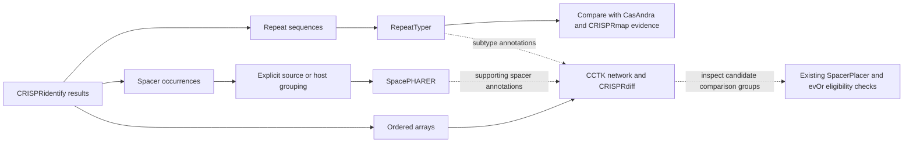

**CRISPRloci v2 tool expansion council — 10 October 2026**

The recommended additions are **(1) RepeatTyper, (2) SpacePHARER, and (3) CCTK's network/CRISPRdiff modules**. They extend three outputs the server already produces: repeats, spacers, and ordered arrays. DefenseFinder is the strongest reserve if the priority shifts toward broader microbial immunity.

This assessment combines local source inspection, current primary literature, official repositories and documentation, and a council of three specialist agents plus a coordinating reviewer. The specialists investigated target biology, defense/mobile-element biology, and integration/comparative analysis, then critiqued the combined shortlist. All three selected the same final set after the critique round. This is an engineering and scientific assessment, not independent experimental validation. No candidate was installed or benchmarked, and production was not accessed.

The ranking prioritizes direct reuse of existing results, distinct biological information, offline execution, manageable dependencies, documented contracts, and licensing suitable for evaluation. Effort labels are relative engineering judgments; they are not measured runtimes or delivery estimates.

The current local implementation contains **nine pinned scientific tools and twelve submission modes**. The lock, API mode definitions and output contracts take precedence over older prose. In particular, an older paragraph in tools/README.md still calls CRISPRmap standalone, while the current API and integration audit contain its queued historical-reference mode. Source capability does not establish the identity of a deployed release. [Pinned versions](../tools/tools.lock.json), [API modes](../backend/src/crispr_web/models.py), [integration audit](../docs/integration-audit-2026-10-03.md).

| Existing component | Pinned version | Current role and useful outputs |
| --- | --- | --- |
| CRISPRidentify v2 | 2.3.2, exact commit distinguishes local revisions | Array detection; source-bound repeat/spacer occurrences, coordinates, categories and strand evidence |
| CasAndra | 0.3.0.dev2 | Cas genes and cassette classifications; source coordinates and explicit missing values |
| CRISPRtracrRNA v3 | 3.0.0 | Type II/V-K candidates and interaction evidence; complete workflow reuses array/Cas evidence |
| SpacerPlacer | 1.0.1.post2 | Ancestral spacer histories, trees, events and parameter estimates for eligible groups |
| evOr | 1.0.2 | Input/reverse acquisition-order comparison and selected reconstruction; unresolved decisions remain explicit |
| CRISPRleader v2 | 2.0.0a1 | Both adjacent flank windows; **biological leader prediction is unavailable** |
| CRISPRrepeat | 1.0.0 | ViennaRNA repeat folds and local array-context structural evidence |
| CRISPRspacer | 0.3.0 | Exact target-to-reference-spacer search and bounded-mismatch spacer-to-viral-reference BLAST search |
| CRISPRmap v2 | 2.0.0a1 | Historical repeat annotation recovery and nearby reference candidates; distinct from repeat subtype prediction |

The twelve modes are detection, reconstruction, orientation, cas, tracrrna, loci, leader, repeats, repeat_context, protospacer, viral_search and repeat_map. The separate CRISPRcasDb catalogue provides reference exploration. BLAST+, MAFFT, Infernal, IntaRNA, ViennaRNA and bundled strand inference are dependencies rather than additional standalone modes. [Current overview](../README.md).

Successful jobs in every mode support a compact result.json. Detection-containing modes also support arrays.json, repeats.json and spacers.json. Limits or inconsistent evidence can make exports incomplete or unavailable, with explicit status or warnings. Existing typed inputs distinguish genomic targets, repeats and spacers; no typed complete-proteome, host-group or general comparative-array input exists. Handoffs currently use explicit files/API submissions, not an automatic workflow scheduler. Repeats and spacers retain occurrence identity, source hashes and source-forward coordinates; two identical sequences in different positions remain different occurrences. [Sequence exchange](../docs/module-exchange.md), [module results](../docs/module-results.md).

Consequently, the earlier proposal to enable detected-spacer-to-viral-search exchange has already been partly delivered and should not be presented as a new tool. The current spacer searches still leave PAM and host inference unevaluated. Existing CRISPRspacer self/supplied-target CLI workflows also remain a useful separate web-integration opportunity; they do not count as new tools in this shortlist.

| Rank | Addition | Existing results consumed | New information | Relative integration burden |
| --- | --- | --- | --- | --- |
| 1 | RepeatTyper, standalone command from CRISPRCasTyper | Repeat sequences, with array/source mappings retained | Repeat-derived subtype evidence, especially for orphan arrays; agreement/disagreement with CasAndra | Low: small text adapter and pinned model; no genomic reference search |
| 2 | SpacePHARER | Spacer occurrences grouped by explicitly identified source/host | Scored phage–host association hypotheses and their supporting matches | Medium: reference/control indexes, grouping contract, structured parsing and resource validation |
| 3 | CCTK network + CRISPRdiff | Ordered arrays and spacer sequences; optionally subtype labels | Observed spacer-sharing relationships and ordered-array comparison without requiring reconstruction eligibility | Low–medium: identity conversion, bounded comparison/rendering and a comparison result contract |

The following connections are proposed. They are not currently implemented pipelines:

**1. RepeatTyper offers the best first integration.** It answers a question the current repeat mapper and folding tools do not answer: what CRISPR-Cas subtype is supported by the repeat sequence? This is particularly useful when an array has no confidently associated Cas cassette, or when repeat and protein evidence disagree.

The standalone `repeatType repeats.txt` command takes uppercase repeats, one per line, and emits repeat, predicted subtype and model probability. It can run without invoking the full CRISPRCasTyper detector. The project uses MIT licensing; current cctyper 1.9.0 was released on 15 September 2026, requires Python >=3.10, and packages its model data. The documentation treats probabilities below 0.75 as uncertain. [Official RepeatTyper instructions](https://github.com/Russel88/CRISPRCasTyper#repeattyper---how-to), [1.9.0 package](https://pypi.org/project/cctyper/1.9.0/).

A release-specific inspection found **37 labels** in the 1.9.0 wheel's cctyper/data/type_dict.tab. This is narrower than the full pipeline's advertised 50 variants. For example, the inspected repeat model lacks VII and III-G/H/I. Pin and expose the actual model vocabulary; a current software release is not evidence that its classifier covers the newest taxonomy. The inspected wheel was cctyper-1.9.0-py3-none-any.whl, SHA-256 `9d1113ef7f6e375253986bc60740942a404b0439e1333da6ed2520ac0224cca7`. Its archive was read without installation or execution. [Exact inspected distribution](https://files.pythonhosted.org/packages/36/7b/fc7c6fe9be7b38c053b415af1237736f6bf38cf8a390274559119f874413/cctyper-1.9.0-py3-none-any.whl).

Proposed adapter: convert repeats.json to the command's text input, keep a private row-to-occurrence map, classify distinct sequences once, and restore every occurrence in the public result. The existing port contains observed repeat occurrences, not an implicit consensus. If a later workflow uses the detector's consensus repeat, identify it explicitly as a derived sequence and retain its array link. Never silently substitute it for observed copies.

Source inspection adds two practical requirements. The CLI accepts A/C/G/T repeats, so ambiguous IUPAC sequences need an explicit unsupported outcome rather than deletion or guessed bases. Some input-error branches exit without a failure code: validate the expected row count, echoed sequences, allowed labels and finite scores in [0,1], not just process success. Its canonical k-mer representation also does not provide strand evidence. [CLI source](https://github.com/Russel88/CRISPRCasTyper/blob/master/bin/repeatType).

The result should contain the submitted repeat, source/array/occurrence IDs, predicted label, native score, uncertainty status and model identity. A locus view can place it beside CasAndra's protein-based call and CRISPRmap's historical labels. Keep these evidence sources separate; an agreement is useful context, while a disagreement may identify an ambiguous association or unsupported family. Do not automatically turn a repeat label into a Cas assignment, PAM rule, or change in tracrRNA model selection.

The principal limitation is a closed-set classifier: an unfamiliar repeat can still receive a high score for one of the available labels. Before enabling a default interpretation, assess family/clade-held-out arrays, orphan arrays, divergent repeat copies, reverse complements and unsupported groups. Measure abstention and subtype-specific error as well as overall accuracy. Validate the model's expected sequence representation against occurrence inputs. The authors' uncertainty threshold is a starting point for evaluation, not a calibrated probability that a locus has that subtype.

**2. SpacePHARER provides the most useful new spacer-side inference.** It combines evidence across spacers to propose phage–host relationships, including translated-sequence searches that can recover more divergent relationships. The method paper establishes this distinct analytical objective; its published performance comparisons are not measurements of the current CRISPRloci pipeline. [SpacePHARER paper](https://pmc.ncbi.nlm.nih.gov/articles/PMC8504623/).

The GPL-3.0 command-line implementation accepts spacer FASTA sets and local phage databases. It uses target and control databases, exposes an FDR threshold, and reports combined association scores plus supporting hits. Detailed output can include nucleotide alignments, coordinates and candidate flanking sequences. These flanks do not themselves establish a PAM rule. The latest tagged release inspected was 5-c2e680a, from April 2021; age warrants an explicit compatibility check. [Implementation and output format](https://github.com/soedinglab/spacepharer), [releases](https://github.com/soedinglab/spacepharer/releases).

Proposed adapter: group spacers.json records by a declared biological source, create one spacer FASTA set per group, and retain a mapping back to every array and spacer occurrence. Start with clearly described per-source sets. A source contig is not necessarily a whole host genome, and one multi-FASTA upload is not evidence that every record belongs to the same organism. Pool contigs only with explicit assembly/host membership; show when a query represents a partial repertoire.

The current viral FASTA collection could supply common reference sequences, after selecting suitable phage records and validating identifiers. SpacePHARER still needs its own indexes and matching control database; existing BLAST indexes are not interchangeable. Provision both outside jobs and pin their identity. The detailed native TSV contains association headers and subordinate hit/alignment records, so it needs a dedicated bounded parser rather than a generic table reader.

Proposed output: one association table with source-set ID, target accession, native combined score, applied FDR policy and supporting-spacer count, plus a separate supporting-hit table linked to occurrence IDs. Join those IDs to observed array position, existing nucleotide matches and evolutionary histories. This lets users inspect whether different array regions are associated with different viral references without inferring infection dates or immune activity.

The strongest objection is statistical and biological: correlated spacers, duplicate hits, sparse repertoires and reference/control composition can distort apparent support. Evaluate host-held-out positives and negatives, shuffled controls and a range of repertoire sizes. Establish an acceptable operating point before release; retain non-significant/empty outcomes. Benchmark CPU, peak memory, temporary disk and cancellation because the tool adapts memory use to the host. Keep a predicted association distinct from a nucleotide match compatible with active targeting.

A June 2026 benchmark of spacer matching explicitly excluded SpacePHARER and iPHoP. Its results support evaluating alternative nucleotide-search engines, including Bowtie1, inside CRISPRspacer. They do not establish whether SpacePHARER's association inference is better or worse. [Neri et al., 2026](https://doi.org/10.1093/bioinformatics/btag394).

**3. CCTK should be integrated selectively for observed-array comparison.** The current server already has a colored spacer presence/absence view with evolutionary trees and events. The additional value is a comparison available directly from detected arrays, including arrays excluded from current evolutionary grouping, plus explicit pairwise spacer-sharing evidence. [Existing history view](../frontend/src/components/results/history/HistoryCanvas.vue), [current grouping implementation](../Integration/crispr_integration/adapter.py).

CCTK's network command accepts arrays from other detectors after a simple conversion: array ID followed by an ordered list of shared spacer IDs. It emits shared-spacer counts, Jaccard similarity and clusters, and accepts optional per-array type annotations. CRISPRdiff draws observed spacers in their supplied order with links between shared spacers. Its native outputs are a plot and optional color-map JSON, **not a structured alignment matrix**. [Network contract](https://crispr-comparison-toolkit.readthedocs.io/en/latest/content/network.html), [CRISPRdiff contract](https://crispr-comparison-toolkit.readthedocs.io/en/latest/content/CRISPRdiff.html).

Version 1.0.3 is GPL-3.0; its tag points to commit fe94fde10a2855cbcc3bf118a253ec097d3a5e46, dated December 2024. The selected comparison modules use a modest Python scientific stack and require no new sequence-reference database. Avoid the package's redundant detection/search paths for the first integration. [Versioned source](https://github.com/Alan-Collins/CRISPR_comparison_toolkit/tree/v1.0.3), [releases](https://github.com/Alan-Collins/CRISPR_comparison_toolkit/releases).

Proposed adapter: construct Array_IDs.txt from arrays.json and a separate sequence-identity table. Existing spacer occurrence IDs cannot serve directly as shared spacer IDs: identical sequences in different arrays intentionally have different occurrence IDs. Preserve both levels. State the sequence identity and reverse-complement policy, preserve observed order and duplicate occurrences, and keep missing/deleted slots explicit in the originating evidence. Never invent an orientation from an unresolved evOr decision.

The first web result should publish validated network edges, isolated arrays, cluster membership, ordered array data and identity mappings. Use the native view to make the relationships inspectable; optionally retain a bounded CRISPRdiff figure as a download. RepeatTyper labels can annotate nodes, and SpacePHARER hits can annotate individual spacers. CasAndra labels require an explicit array–cassette association with its uncertainty retained; a Cas call on a source does not classify every array on that source. This creates useful connections among all three additions.

The strongest objection is overlap with the existing history browser. Acceptance should therefore require a detection-only comparison that works without inferred ancestors, exposes the actual spacers supporting each edge, and includes isolated arrays. For a transitive A–B–C group, show when A and C share nothing. A sharing network is not a phylogeny, and its clusters must not silently replace the current reconstruction eligibility rules. Sending a selected group into evolution requires retaining original genomic input and passing the existing checks; current evolution modes do not accept arbitrary array JSON.

For predictable web execution, use fixed row ordering, a fixed color seed and explicit limits on arrays, spacers, edges and plot pixels. CRISPRdiff's documented automatic ordering enumerates orders for up to eight arrays and uses a heuristic for larger sets; `--preordered` bypasses that optimization. Independently recompute edge counts/Jaccard values and test repeated spacers, reverse complements, no-overlap cases and partial arrays. A later Constrain extension could compare histories on an independently supplied tree, but needs an explicit leaf mapping and must reject polytomies, which upstream warns it can mishandle. [Ordering documentation](https://crispr-comparison-toolkit.readthedocs.io/en/latest/content/CRISPRdiff.html), [Constrain requirements](https://crispr-comparison-toolkit.readthedocs.io/en/latest/content/constrain.html).

The wider search produced the following alternatives. These exclusions concern the immediate reuse-and-ease objective, not whether the methods are scientifically worthwhile.

| Alternative | Potential connection | Why it did not enter the first three |
| --- | --- | --- |
| **DefenseFinder / AntiDefenseFinder** | Original genome or complete ordered proteome → non-CRISPR defense/anti-defense predictions → locus-coordinate context | Strongest reserve. Current v3.0.0 accepts nucleotide input, but filtered CasAndra hits cannot replace a full proteome. Main reuse is common input and coordinate joins. Pin tool and models separately; initial scope should use the CPU HMM workflow. [Usage](https://github.com/mdmparis/defense-finder), [v3.0.0](https://github.com/mdmparis/defense-finder/releases/tag/v3.0.0). |
| **PADLOC** | Genomic/protein annotation plus array evidence → defense systems | Its array import expects CRISPRDetect-style GFF and quality attributes, not arbitrary array JSON. Scores cannot be transferred between detectors without justification. Less direct integration than the selected consumers. [Input documentation](https://github.com/padlocbio/padloc/blob/master/etc/README.md), [parser](https://github.com/padlocbio/padloc/blob/master/bin/padloc.R). |
| **geNomad** | Target genomes → virus/plasmid/provirus context for spacer hits | Excellent ecological addition. Actual current license restricts academic/internal noncommercial use; public-service applicability must be settled. Marker databases and memory also need evaluation. [Workflow](https://portal.nersc.gov/genomad/quickstart.html), [license](https://github.com/apcamargo/genomad/blob/main/LICENSE). |
| **Spacer2PAM** | Spacers + repeat + direction + target matches → candidate PAMs | Strong scientific synergy, but documented Entrez/BLAST, taxonomy mapping and optional PHASTER workflow needs offline adaptation. The documented taxonomy database was about 65 GB; this is not a measured requirement for a redesigned local workflow. [Implementation](https://github.com/grybnicky/Spacer2PAM), [paper](https://pmc.ncbi.nlm.nih.gov/articles/PMC8990532/). |
| **PAMpredict** | Consistently oriented spacers + local target FASTA → flank statistics and candidate motifs | Promising CPU route, but actual code license is CC BY-NC-ND 4.0; cannot assume unrestricted modification/deployment. Sparse independent targets and orientation remain scientific issues. [Usage](https://github.com/Matteo-Ciciani/PAMpredict), [license](https://github.com/Matteo-Ciciani/PAMpredict/blob/master/LICENSE). |
| **PAMPHLET / PAMPHLET-LOCAL** | Spacers + repeat + Cas protein → homology-expanded PAM evidence | Especially attractive multi-input design. Local variant exists, but needs bacterial/protospacer/protein reference preparation, lacks a clear root license in the inspected repository, and requires a protein extraction contract. The network version is not the same deployment proposition as the local variant. [Local CLI](https://github.com/GolshkovQ/PAMPHLET-LOCAL), [2025 paper](https://doi.org/10.1016/j.jgg.2024.10.014). |
| **Protein2PAM** | Cas8/9/12 proteins → PAM predictions | New protein port plus model/GPU infrastructure and noncommercial code/model terms. Better as a later specialized project. [Repository and licensing](https://github.com/Profluent-AI/protein2pam). |
| **CICERO / CRISPR-PAMdb** | Cas9 sequence → PAM profile | Newer MIT research implementation; promising protein-side pilot, but Cas9-specific, based on a 650M-parameter model, and packaged as research scripts/checkpoints. [Code](https://github.com/Schwank-Lab/CRISPR-PAMdb), [2026 paper](https://www.nature.com/articles/s41467-026-69098-5). |
| **CRISPRTarget local CLI** | Detected spacers → target matches, controls and PAM context | A current standalone CLI exists, including 2026 database instructions; treating it as web-only would be outdated. It overlaps the current BLAST workflow, needs its own input adapter, and no clear software license was visible in the inspected root. [Official repository](https://github.com/davidchyou/CRISPRTarget). |
| **iPHoP** | Viral genomes → combined host predictions | Useful future viromics expansion, with substantial reference infrastructure and a virus-first input contract. Existing spacer evidence must not be counted twice as independent support. [Official documentation](https://github.com/simroux/iphop/blob/main/README.md). |
| **clinker** | Annotated locus windows/proteins → gene-cluster similarity views | Strong synteny option after source-bound CDS translations and annotated windows are exported. Current Cas result JSON is not a complete annotated GenBank input. [Repository](https://github.com/gamcil/clinker). |
| **AcrFinder / AcRanker** | Self-targeting, neighborhood or protein evidence → candidate anti-CRISPRs | AcrFinder adds overlapping detection/reference machinery; AcRanker needs protein inputs and clearer deployment/licensing evidence. Defer until a specific anti-CRISPR investigation is supported. [AcrFinder](https://github.com/HaidYi/acrfinder), [AcRanker](https://github.com/amina01/AcRanker). |

PAM inference remains a high-value next research direction. Its intuitive connection to spacers, targets and Cas proteins is real. It falls outside the first delivery set because the reviewed implementations require more preparation, and many loci lack enough independent target matches or an unambiguous effector/direction assignment. Acquisition order from evOr must not be equated with transcription strand. A motif inferred from target context remains a hypothesis; generic DNA-PAM logic is not applicable to every CRISPR type.

The council's critique changed or sharpened several conclusions:

| Reviewer | Main challenge | Resolution |
| --- | --- | --- |
| Target biology | SpacePHARER could be mistaken for another BLAST wrapper; source grouping may fabricate support. | Recommend its combined association inference with explicit grouping and separate nucleotide evidence. |
| Defense biology | DefenseFinder adds more biological breadth than another comparison package. | Retain it as fourth because this request emphasizes consuming current results; do not feed it a Cas-only proteome. |
| Integration/comparative analysis | CCTK overlaps an existing history view; RepeatTyper's advertised full-pipeline vocabulary is misleading. | Limit CCTK to observed comparison/network first; inspect and publish the actual 37-class model vocabulary. |
| Coordinator | PAM tools appear ideal in diagrams but not all are ready for a pinned offline service. | Distinguish conceptual synergy from ready input contracts, software rights, references and runtime needs. |

A practical implementation sequence is **RepeatTyper first**, followed by **CCTK network/observed comparison**, then **SpacePHARER after its reference and grouping evaluation**. This delivery order differs from scientific priority because the two database-free adapters are smaller steps. A complete automatic workflow scheduler is not necessary for an initial release; explicit versioned handoffs fit the existing design.

Each implemented addition would need a pinned executable/model identity, operator-provisioned immutable references where relevant, an isolated worker stage, independent Integration and backend validation, a compact result projection, compatible frontend inputs/views, and real scientific release fixtures. Preserve capability-protected downloads, bounded reads, cancellation, retention and process containment. Keep SpacerPlacer and evOr environments separate. Contract and browser-flow changes would require scripts/check.sh and appropriate browser checks. [Integration rules](../Integration/AGENTS.md), [backend rules](../backend/AGENTS.md), [frontend rules](../frontend/AGENTS.md).

This task adds only a research report and its index link. Runtime performance, scientific error rates and deployed availability of the proposed integrations remain untested. Document links and the repository private-data scan were checked; application tests were not run for this documentation-only change.
